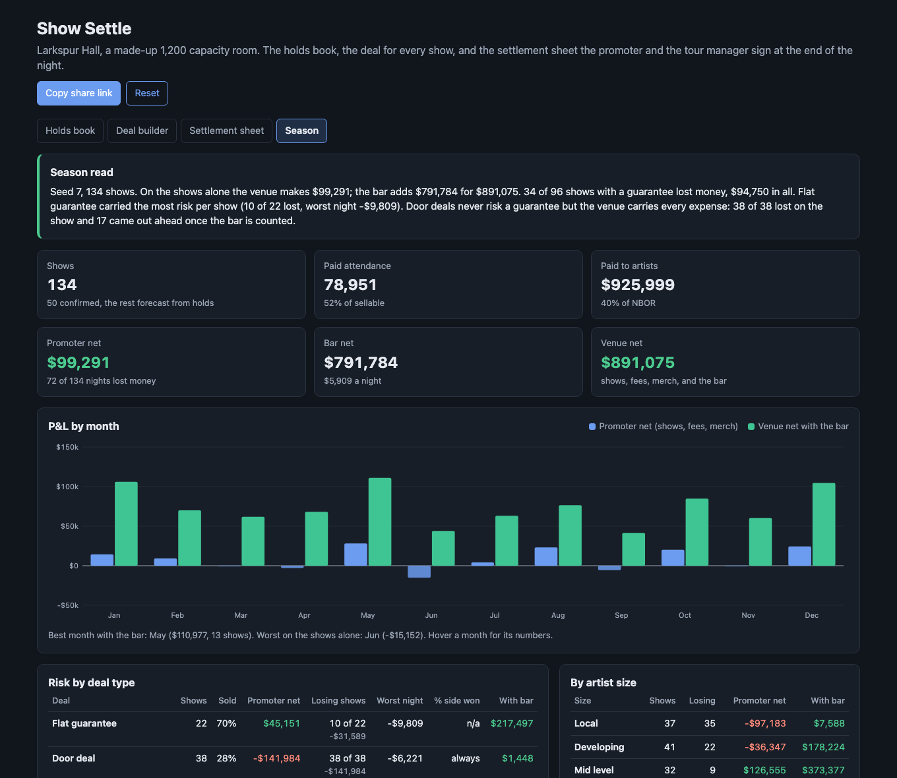

# Show Settle

A browser tool for the booking desk and the box office of a made-up 1,200 capacity independent music venue, Larkspur Hall. It keeps the holds book (first, second, and third holds on each date, challenges with a deadline, confirmations that clear the other holds, and radius clause checks against five nearby rooms), builds the deal for each show (flat guarantee, door deal, guarantee versus percentage, guarantee plus backend) with walkout potential and break-even attendance, and produces the settlement sheet the promoter and the artist's tour manager sign at the end of the night: ticket sales by price level with comps and kills, facility fees, ticket fees, and sales tax down to net box office, show expenses with caps and undocumented items, the artist payout, the merch split, and the balance due. A seeded season of about 120 shows rolls the book forward into a venue P&L by month and by deal type.



## Why

An independent room lives or dies on two things that happen far apart: what the talent buyer agrees to months out, and what the settlement says at midnight. The holds book decides which nights the room is dark and which act gets the Saturday. The deal decides who carries the risk: a flat guarantee puts all of it on the venue, a door deal puts it on the artist, and a versus deal splits it. The settlement is where both sides find out, line by line, whether the marketing was over its cap, whether the hospitality receipt exists, and whether the percentage beat the guarantee. This puts the whole chain in one place so the trade can be seen: which deal types lose money, how much the bar has to carry, and what a given guarantee needs at the door.

Results for the 2027 season, five seeds (default settings, all shows forecast from the same book logic):

| Seed | Shows | Paid (of sellable) | Paid to artists | Promoter net | Bar net | Venue net | Nights the promoter lost |
|---|---|---|---|---|---|---|---|
| 7 | 134 | 78,951 (52%) | $926k | $99k | $792k | $891k | 72 |
| 11 | 119 | 68,772 (51%) | $692k | $110k | $698k | $809k | 58 |
| 23 | 110 | 62,474 (50%) | $689k | $100k | $633k | $732k | 58 |
| 42 | 110 | 61,871 (50%) | $701k | $55k | $618k | $673k | 61 |
| 99 | 104 | 60,843 (52%) | $632k | $102k | $629k | $731k | 53 |

Risk by deal type, seed 7:

| Deal | Shows | Sold | Promoter net | Losing nights | Lost on those | Worst night | Percentage won | Venue net with bar |
|---|---|---|---|---|---|---|---|---|
| Flat guarantee | 22 | 70% | $45,151 | 10 | -$31,589 | -$9,809 | n/a | $217,497 |
| Door deal | 38 | 28% | -$141,984 | 38 | -$141,984 | -$6,221 | always | $1,448 |
| Guarantee vs percentage | 50 | 48% | $88,826 | 18 | -$41,117 | -$5,992 | 22 | $362,624 |
| Guarantee plus backend | 24 | 84% | $107,298 | 6 | -$22,045 | -$4,746 | 6 | $309,506 |

Promoter net is the settlement result plus what the venue keeps outside it (facility fees, ticket fee rebates, merch commission, the house nut over the real house cost) less the expense overages it ate. Venue net adds the bar.

What the season shows:

- **The shows roughly break even; the bar is the business.** Over five seeds the promoter side nets $55k to $110k on 104 to 134 shows, about half of which lose money on their own. The bar adds $600k to $800k. That is the honest shape of a room this size, and the reason a talent buyer will book a soft night to keep the bar open.
- **Flat guarantees carry the most risk per show.** They go to the bigger acts, so the average night is good, but nothing comes back on a soft night: 10 of 22 lost, the highest loss rate of the guarantee deals and the most lost per show booked ($1,436).
- **Versus deals are the best risk trade.** A lower guarantee caps the downside (worst night -$5,992) and the percentage side pays the artist only when the door is there. The percentage won on 22 of 50 nights.
- **Door deals never risk a guarantee and still lose on the show every time.** The venue carries every expense and keeps only the house share of a 28% full room. With the bar, 17 of 38 come out ahead, and the door deal total is about flat. Local nights are filler for the bar, not a profit center.
- **Caps and paperwork move real money.** On the default sheet (Jan 1, flat guarantee), three capped lines leave $384 the venue cannot charge back. Switching undocumented items from "held to estimate" to "struck" changes what the artist sees on versus and backend deals.

## How it works

```
 seed -> holds book for 2027: ~160 dates with 1 to 4 ranked holds, early months mostly confirmed,
         a few open challenges, and each artist's other dates at five nearby rooms (radius clauses)
                                          |
   desk actions from the URL (challenge, confirm, release, advance the desk date) replay on the book
                                          |
   resolve the season: confirmed dates play; open dates go down the holds in order, each confirming
   with probability 0.55 unless a radius clause blocks it
                                          |
   per show: deal type by artist size, offer from expected net, seeded demand (day of week, month,
   lognormal), advance vs walk-up, expense actuals with overruns and missing receipts, merch, bar
                                          |
   settle(): gross -> facility fee -> ticket fees -> sales tax -> NBOR -> expenses (caps, policy)
             -> artist payout -> merch -> deposit -> balance due -> venue P&L
                                          |
            +-------------------------+---------------------------+-----------------------+
       settlement sheet           season P&L by month         risk by deal type      deal builder
```

- **Holds.** Holds on a date rank in the order they were placed. Only the first hold can confirm. A lower hold that is ready to confirm challenges the hold directly ahead of it, which then has 3 days (inclusive of the deadline day) to confirm or release. Silence is a release. When the hold ahead releases, the challenger moves up; if it is now first it confirms, otherwise the challenge moves to the new hold ahead with a fresh window. A confirmation releases every other hold on the date and closes the challenge (won or lost). The challenger releasing voids it.
- **Radius clauses.** Ours: 50 miles, 60 days before and 30 after. Each nearby room has its own (The Wren 25 miles, Harbor Pavilion 100 miles and 90 days before). A hold conflicts if the artist plays inside our window at a room inside our radius, or if our date falls inside that room's window. A conflicted hold cannot confirm or challenge.
- **Room.** 950 GA floor and 250 reserved balcony. Kills come off first (24 for the FOH riser, 10 for a camera position on mid and established shows, 20 for a barricade on established shows), then comps (artist guest list on the floor, venue and promo comps in the balcony). The first 150 floor tickets are early bird, then advance, then day of show at the box office.
- **Deals.** Flat pays the guarantee. Door pays a share of NBOR. Versus pays the greater of the guarantee and a share of NBOR after show expenses; the split point is expenses + guarantee / pct. Plus backend pays the guarantee and a share of NBOR over a split point of expenses + guarantee + promoter profit (15% of expenses and guarantee). Deal type follows artist size, and the guarantee is set from the expected net at the artist's usual draw.
- **Settlement order.** Prices are all in. Gross by price level; less a $2.00 facility fee per paid ticket; less the ticket fee ($4.25 online, $1.00 at the box office); less 7% sales tax, which is inside what is left (remainder x 0.07 / 1.07); equals NBOR. Expenses: sound, lights, production rider rentals, security (one guard per 75, four minimum), stagehands, box office, hospitality buyout, marketing, insurance per head, card processing (2.9% of gross), performing rights (1.5% of NBOR), and the house nut. Caps apply to rider rentals, hospitality, and marketing. Undocumented items are held to the deal memo estimate, struck, or allowed, by policy. Balance due is the payout less the deposit (50% of any guarantee), the merch tax the artist collected, and the venue's merch commission (20% of soft goods, 10% of hard goods, after tax).
- **Venue P&L.** The venue copy of the sheet adds what the artist never sees: overages it ate, the house nut against the real cost of opening the doors, facility fees, ticket fee rebates ($1.25 per online ticket, the full box office fee), merch commission, and the bar (gross less 26% cost of goods and bartender labor).

The engine is `src/settle.js` with no DOM code. A full season (book, resolution, ~130 settlements) runs in about 15 ms. The deal builder scans every attendance for the three break-evens in about 30 ms.

## What you see

- **Holds book.** A month calendar with each date's holds colored by priority (confirmed, 1st, 2nd, 3rd and lower), flags for open challenges and radius conflicts, and a date panel to confirm, challenge, or release, with the reason any button is blocked. Advance the desk date to watch deadlines lapse. Open challenges and the desk log sit below.
- **Deal builder.** Artist size, deal type, terms, prices, and per head spend. Tiles for walkout potential, gross potential, and break-even attendance three ways (as settled; with fees, rebates, and merch; with the bar). A chart of artist payout and promoter result at every attendance, and the deal memo.
- **Settlement sheet.** Laid out as a printed sheet: ticket sales with comps, kills, and a capacity check; deductions to NBOR; expenses with estimate, actual, charged, and notes; the deal calculation; merch; the balance due; each side's totals; and signature lines. The venue copy (P&L) can be hidden. Print styles print the sheet alone on white.
- **Season.** Totals, P&L by month as paired bars on one axis (promoter net and venue net with the bar), risk by deal type and by artist size, and every show, each linking to its sheet.

The view, the desk actions, and the deal live in the URL hash, so a book state or a deal can be shared as a link. Light and dark mode follow the system. Tooltips on column heads and expense lines explain each term.

## Run it

It is a static site with no build step and no dependencies. ES modules need a web server, so `file://` will not work. From this folder run:

```bash
python3 -m http.server 8000
```

Then open http://localhost:8000.

## Tests

```bash
npm test        # or: node --test
```

38 tests cover the engine:

- Holds: rank by placement order, no duplicate holds, no holds on a confirmed date, only the first hold confirms, a first hold cannot challenge, one open challenge per date, the deadline inclusive of its last day and lapsing the day after, the first hold answering by confirming, a third hold's challenge cascading to the first with a fresh window, the challenger releasing, confirmations clearing every other hold, and URL action replay skipping invalid steps.
- Radius clauses: inside and outside our window at the exact boundary days, distance outside both clauses, a different artist, and another room's clause blocking our date when ours does not.
- Deals on hand-worked numbers: flat, door, versus where the guarantee wins and where the percentage wins (and the two sides equal at the split point), and plus backend above and below its split point.
- Settlement: the fee and tax order of operations to the cent, box office fees and rebates, expense caps, the three undocumented policies (and a capped line with no backup), percentage lines from gross and NBOR, the merch split and balance due, no deposit on door deals, and inventory allocation never overselling.
- Deal builder: break-even is the first paid count at or above zero for all three measures and ordered as expected, a bigger guarantee raises it, an impossible one has none, and walkout potential equals the payout at a sellout.
- Season: book and season determinism by seed, one confirmation per date, about 120 shows with one per date, confirmed dates playing the confirmed act and conflicted holds never playing, every settlement balancing (gross, NBOR, payout, merch, and capacity), the venue P&L equal to cash in minus cash out, months and deal types summing to the totals, deal types matching artist size, and URL state round trips and clamping.

## Calibration, honestly

Every number is a hand-set assumption, not fit to data: draws by artist size, demand multipliers by day and month, fee and tax rates, expense rates, overrun and missing-receipt rates (7%), per head merch and bar spend, and the 0.55 chance a hold confirms. I lowered the house nut and cut stagehands for local shows after a first pass where every local night lost $3,000 or more, which is not how a real room books them. Seed 7 is the default because it was the first one tried; it gives the most shows of the five seeds above.

## CI and deploy

`.github/workflows/ci.yml` runs `npm test` on Node 22 for every push and pull request. On push to `main` a second job publishes the site to GitHub Pages with `actions/upload-pages-artifact@v3` and `actions/deploy-pages@v4`. Set Pages to "GitHub Actions" as the source in the repo settings. The workflow has not been run locally.

## Production notes

- The holds book belongs in a database with an audit log, not in a URL: every hold, challenge, and response timestamped with who made it, and notifications to the agent when a challenge lands or a deadline is a day out.
- Deadlines in practice run on business days and the agent's time zone, and some houses set 24 or 48 hours. The window should be per agent and per deal, and holiday aware.
- Ticket counts and gross come from the ticketing platform's settlement report and the box office drawer, not a model. The sheet should reconcile against both and flag a mismatch before anyone signs.
- Expenses come from invoices and payroll, with receipts attached to each line so the tour manager can check them on a phone at midnight. The undocumented policy is a deal memo term, not a dropdown.
- Radius checks need the artist's actual routing from the agent and announced dates from the market, and approvals are often granted. A conflict should open a request, not just block.
- Real settlements also handle withholding tax for foreign artists, cash buyouts, production overages billed back, and split bills with support acts, each with its own line.

## License

MIT. See [LICENSE](LICENSE).
